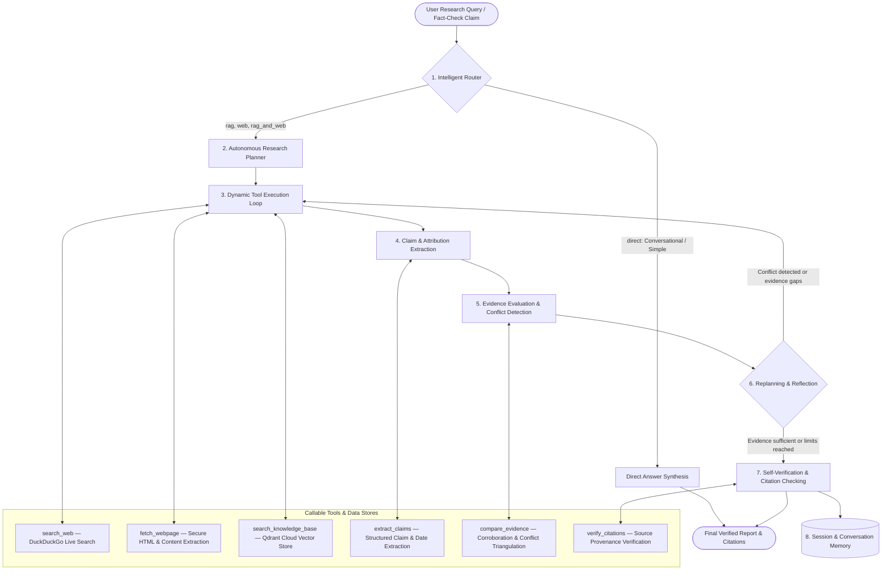

# CivicLens — Autonomous Agentic AI Research & Fact-Checking Platform

CivicLens is a production-grade, deployment-ready **Autonomous Agentic AI Research, Fact-Checking and Deep Verification Platform**. Built with Streamlit, LangGraph, Qdrant Cloud, Groq, and Sentence-Transformers, the system operates as an **autonomous, tool-using research agent** capable of dynamic planning, context-aware tool selection, multi-step execution, evidence triangulation, contradiction detection, iterative replanning, and self-verification.

---

## 🏛️ System Architecture



---

## ✨ Core Capabilities

### 1. Intelligent 4-Mode Query Routing
- `direct`: Answers conversational or self-contained queries without search overhead.
- `rag`: Retrieves targeted chunks from indexed documents in Qdrant.
- `web`: Investigates external events, news, and arbitrary research domains via live web tools.
- `rag_and_web`: Cross-verifies uploaded documents against current external web sources.

### 2. Autonomous Research Planner
- Dynamically breaks complex inquiries into specific sub-objectives, perspectives, and targeted search queries.
- Bypasses unnecessary planning overhead for simple or self-contained questions.

### 3. Real Callable Tools
- `search_web(query, max_results)`: DuckDuckGo live web and news search.
- `fetch_webpage(url)`: SSRF-protected, stream-bounded HTML text extractor with script/style stripping.
- `search_knowledge_base(query, filters, top_k)`: Vector similarity search against Qdrant Cloud chunks with metadata filters.
- `extract_claims(text)`: Structured extraction of verifiable claims, attributions, dates, and figures.
- `compare_evidence(claims, sources)`: Triangulates claims against evidence, detecting conflicts and source disagreements.
- `verify_citations(answer, sources)`: Validates that inline citations (`[KB-1]`, `[WEB-1]`) reference actually retrieved sources.

### 4. Qdrant Cloud Integration & Multi-Format Ingestion
- **Qdrant Cloud Free Tier**: Persistent storage of vector embeddings and metadata across application restarts and public deployments.
- **Local Fallback**: Automatically operates on local persistent Qdrant storage (`data/qdrant_storage`) if cloud credentials are not supplied.
- **Supported Formats**: PDF (`.pdf`), Microsoft Word (`.docx`), Markdown (`.md`), Plain Text (`.txt`), CSV (`.csv`), JSON (`.json`).
- **Content-Hash Deduplication**: SHA-256 content hashing skips reprocessing unchanged files and automatically updates modified documents.

### 5. Evidence Triangulation & Fact-Checking Verdicts
- Automatically assigns evidence-based verdicts to fact-checked claims:
  - **Supported**: Corroborated by independent authoritative sources.
  - **Contradicted**: Disputed by authoritative evidence or contradicted across independent records.
  - **Partially Supported**: Certain aspects substantiated while others lack corroboration.
  - **Insufficient Evidence**: Available records are insufficient to verify or refute the assertion.

### 6. Transparent, Live Streamlit Research Workspace
- **Main Research Interface**: Real-time execution terminal with timestamped tool calls, dynamic plan card, inline citations, claim matrix, and Markdown export.
- **Dedicated Knowledge Base Workspace**: Live document inventory directly queried from Qdrant, multi-file uploader, duplicate detection feedback, and interactive vector search playground.
- **Diagnostics & Config**: Live Groq API latency meter, Qdrant cluster connectivity inspector, and configurable bounds.

---

## 🚀 Local Setup Instructions

### Prerequisites
- Python 3.10+ (tested on Python 3.14)
- [Groq API Key](https://console.groq.com/keys) (Free tier available)
- [Qdrant Cloud Account](https://cloud.qdrant.io) (Free tier available; local fallback supported)

### Step 1: Clone & Create Virtual Environment

**Windows (PowerShell):**
```powershell
python -m venv .venv
.\.venv\Scripts\Activate.ps1
```

**Linux / macOS:**
```bash
python3 -m venv .venv
source .venv/bin/activate
```

### Step 2: Install Dependencies
```bash
python -m pip install --upgrade pip
pip install -r requirements.txt
```

### Step 3: Environment Configuration
Copy `.env.example` to `.env`:
```bash
copy .env.example .env     # Windows
cp .env.example .env       # Linux / macOS
```

Edit `.env` and fill in your credentials:
```ini
# Required: Groq LLM API Key
GROQ_API_KEY=gsk_your_groq_api_key_here

# Optional: Groq Model
GROQ_MODEL=openai/gpt-oss-120b

# Optional: Qdrant Cloud (Leave blank for local persistent Qdrant)
QDRANT_URL=https://your-cluster-id.region.aws.cloud.qdrant.io:6333
QDRANT_API_KEY=your_qdrant_api_key_here
QDRANT_COLLECTION_NAME=agentic_research_kb

# Agent execution bounds
MAX_AGENT_ITERATIONS=5
MAX_UNIQUE_SOURCES=8
MAX_RAG_PASSAGES=6
```

### Step 4: Run the Application
```bash
streamlit run app.py
```
Open your browser at `http://localhost:8501`.

---

## ☁️ Qdrant Cloud Setup Guide

1. Sign up for a free account at [cloud.qdrant.io](https://cloud.qdrant.io).
2. Click **Create Cluster** and select the **Free Tier (1 GB RAM, 0.5 vCPU)**.
3. In your cluster dashboard, copy the **Cluster URL** (e.g., `https://xyz-example.eu-central.aws.cloud.qdrant.io:6333`).
4. Under **API Keys**, click **Create Key** and copy the generated key.
5. Paste both values into your `.env` file or Streamlit Cloud Secrets:
   ```ini
   QDRANT_URL=https://your-cluster-id.region.aws.cloud.qdrant.io:6333
   QDRANT_API_KEY=your_qdrant_api_key
   QDRANT_COLLECTION_NAME=agentic_research_kb
   ```

---

## 🌐 Public Deployment (Streamlit Community Cloud)

1. Push your repository to GitHub.
2. Sign in to [share.streamlit.io](https://share.streamlit.io).
3. Click **New app** and select your repository, branch, and `app.py` as the main entry file.
4. Open **Advanced settings** -> **Secrets** and enter your credentials:
   ```toml
   GROQ_API_KEY = "gsk_your_groq_api_key"
   GROQ_MODEL = "openai/gpt-oss-120b"
   QDRANT_URL = "https://your-cluster-id.region.aws.cloud.qdrant.io:6333"
   QDRANT_API_KEY = "your_qdrant_api_key"
   QDRANT_COLLECTION_NAME = "agentic_research_kb"
   ```
5. Click **Deploy**. The platform will be publicly accessible.

---

## 🧪 Testing & Verification

Run the entire automated test suite:
```bash
.\.venv\Scripts\python.exe -m pytest -v
```

All **50 test cases** across all test suites run with 100% pass rate:
- `tests/test_scenarios.py`: Validates all 10 agentic scenarios (Direct routing, Document RAG, Multi-tool investigation, Replanning, Conflict detection, Verdicts, Memory, Deduplication, Persistence, Transparency).
- `tests/test_agent.py`: Validates LangGraph state machine, nodes, conditional edges, and parsing.
- `tests/test_knowledge_base.py`: Validates Qdrant collection lifecycle, PyMuPDF extraction, docx parsing, and deduplication.
- `tests/test_tools.py`: Validates URL safety, DuckDuckGo searches, content fetching, and claim comparison.

---

## 📁 Repository Structure

```
Agentic AI project/
├── app.py                      # Modern Streamlit UI with live terminal & workspaces
├── agent.py                    # LangGraph autonomous agent workflow
├── tools.py                    # Real callable tools (Search, Fetch, KB, Claims, Compare, Verify)
├── router.py                   # 4-mode intelligent query classification
├── memory.py                   # Session conversation memory & token budget window
├── knowledge_base.py           # Qdrant Cloud integration, multi-format extraction & hashing
├── config.py                   # Configuration, presets, limits & constants
├── requirements.txt            # Dependency manifest
├── .env.example                # Environment configuration template
├── README.md                   # Comprehensive platform documentation
├── tests/
│   ├── test_scenarios.py       # 10 complete agentic demonstration scenario tests
│   ├── test_agent.py           # Workflow, planning & conditional edge tests
│   ├── test_knowledge_base.py  # Ingestion, chunking, and vector tests
│   └── test_tools.py           # Tool functionality & safety validation tests
└── data/
    ├── documents/              # Ingested PDF, DOCX, TXT source files
    ├── qdrant_storage/         # Local persistent Qdrant storage (fallback)
    ├── cache/                  # Web request & search cache
    └── metadata.json           # Catalog of ingested documents and content hashes
```

---

## ⚖️ License
MIT License. Open-source for research, fact-checking, and educational use.
